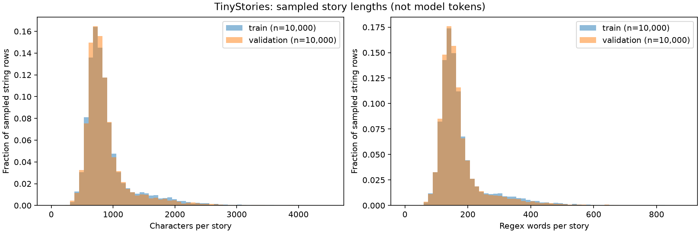

# TinyStories exploratory analysis

Dataset: [roneneldan/TinyStories](https://huggingface.co/datasets/roneneldan/TinyStories).
Revision: `f54c09fd23315a6f9c86f9dc80f725de7d8f9c64`. Seed: 42.

The full official splits were loaded; statistics below describe only the selected rows. Selection is uniform without replacement within each split, using independent seeded Python random generators. No splits are merged.

Words are lowercase English-letter regex matches, with internal apostrophes retained. They are **not model tokens**. Characters use Python `len(text)`. Quantiles use NumPy's default linear interpolation; standard deviation is the population value. Vocabulary and frequencies include stop words.

| Split | Full rows | Analysed rows | Mean words | Median | p95 | Max |
|---|---:|---:|---:|---:|---:|---:|
| train | 2,119,719 | 10,000 | 175.7 | 153.0 | 352.0 | 886.0 |
| validation | 21,990 | 10,000 | 171.5 | 151.0 | 331.0 | 840.0 |

## train

Schema: `{'text': Value('string')}`.

Missing/null: 0; non-string: 0; empty/whitespace: 4; exact duplicate rows beyond the first: 14.

Observed lowercase vocabulary: 9,667 words.

Frequent words (occurrences): the (95,620), and (85,261), to (59,432), a (54,358), was (44,183), he (38,029), she (35,926), they (32,250), it (31,648), her (23,341), said (16,938), in (15,449), you (15,251), his (15,140), with (14,859)

Stories longer than each word threshold: 128: 7,713, 256: 1,173, 512: 74, 1024: 0

Example excerpts (up to 500 characters, from sampled rows):

> Once upon a time there was a white phone. The phone was special and could fold out. One day, a little girl, who was three years old, saw the phone and said "Wow!" 
> 
> The girl wanted to play with the phone, so she carefully folded out the phone. She thought the phone looked like a butterfly. She was very excited and started to giggle.
> 
> The girl's mother saw her playing with the phone and said, "No, you must be gentle with it. Folding the phone out is a special thing you can only do when you get ol

> Imagine a big field. It's full of bright, green grass. In the middle of the big field, there was a football. All around the football were lots of excited children. They were running, jumping and trying to kick the football.
> 
> The sun was shining down, making the field feel safe and warm. There were no worries, only fun. The children were playing together, enjoying their time. 
> 
> Suddenly, one of the children kicked the football. It soared up and flew across the sky. Everyone on the field was fille

> Once upon a time, there was a nosy little cat called Fluffy. One day, Fluffy was wandering around when she noticed something shiny. It was a pattern of lines on the ground. She had never seen anything like it before and couldn't help but have a closer look. She started to stir the lines with her paw.
> 
> When she stirred, something magical happened. Suddenly, the lines began to move around and turn into shapes and colours. Fluffy couldn't believe her eyes!
> 
> Soon, the shapes and colours began to mov

## validation

Schema: `{'text': Value('string')}`.

Missing/null: 0; non-string: 0; empty/whitespace: 0; exact duplicate rows beyond the first: 0.

Observed lowercase vocabulary: 9,481 words.

Frequent words (occurrences): the (93,470), and (83,216), to (59,276), a (53,217), was (44,749), he (37,238), she (35,382), it (30,970), they (29,886), her (23,217), said (16,185), his (15,168), in (14,913), with (14,401), you (13,552)

Stories longer than each word threshold: 128: 7,657, 256: 972, 512: 75, 1024: 0

Example excerpts (up to 500 characters, from sampled rows):

> Once upon a time, there was a thoughtful girl named Sue. Sue loved to help her mom around the house. One day, her mom asked her to wipe the table after they ate their lunch. Sue was happy to help.
> 
> As Sue was wiping the table, she saw a pretty candle on the window sill. The candle was her mom's favorite. Sue wanted to do something nice for her mom, so she said, "Mom, can I light the candle for you?" Her mom said, "Yes, but be very careful."
> 
> Sue carefully lit the candle and put it on the table. 

> Once upon a time, there was a kind farmer. He had a big cow. The cow was sad. The farmer did not know why.
> 
> One day, a little boy came to the farm. He saw the sad cow. The boy kneeled down to talk to the cow. "Why are you sad, cow?" he asked. The cow said, "I am lonely. I want a friend."
> 
> The kind farmer heard the cow. He wanted to help. So, he got another cow to be friends with the sad cow. The sad cow was happy now. They played together every day. And the kind farmer, the little boy, and the t

> Once upon a time, there was a girl named Mia. Mia loved her jewelry. She had a big box full of pretty things. She liked to wear them all day. But at night, she had to sleep.
> 
> One day, Mia met a talking cat named Tom. Tom was a tough cat, but he was nice. Tom said, "Hi, Mia! I like your jewelry. Can I wear some too?" Mia said, "Yes, Tom. You can wear my jewelry, but we have to give it back before we sleep."
> 
> So, Mia and Tom played together. They wore the jewelry and had fun. They pretended to be 

## Split overlap and interpretation

Distinct exact texts shared by the analysed train and validation rows: **10** (SHA-256 of unchanged UTF-8 text). This is a sample-only exact-match check, not a full-corpus leakage audit; paraphrases and whitespace differences are not detected.

Before training, explicitly filter empty stories and audit exact duplicates across the full splits. If overlap is confirmed, keep validation fixed and remove matching training stories; record the cleaning rule and resulting split sizes. The current EDA does not modify or deduplicate the source data.

Use the length distribution to guide a later tokenizer-specific analysis. For example, a 256-word story may exceed 256 subword tokens. Do not choose a context length or estimate truncation from word counts alone. Measure token lengths with the chosen tokenizer and consider packing short stories with explicit end-of-story boundaries. Keep the official validation split separate and fit any tokenizer on training data only.

No tokenizer, training run, GPU benchmark, or performance claim is included. Machine-readable statistics, selected original row indices, environment versions and dataset fingerprints are recorded in `summary.json`.
